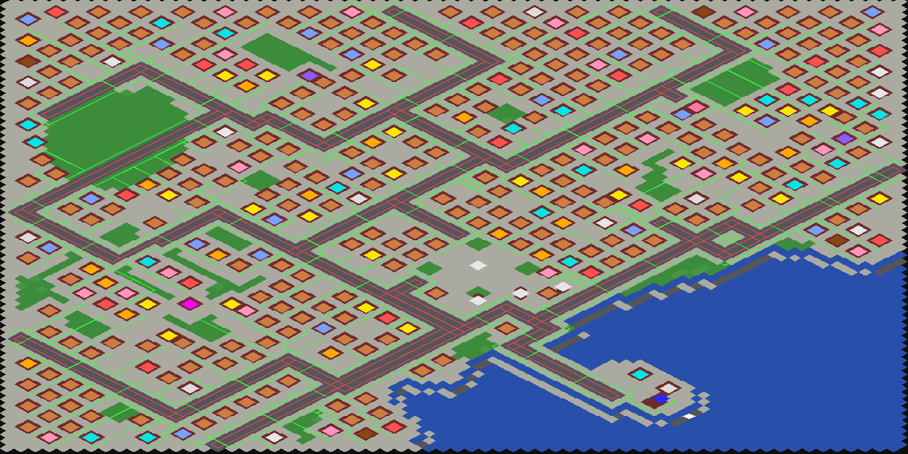

# Pizza Syndicate: fünf neue Städte

**English:** Five new, hand-designed cities for the 1999 business sim *Pizza Syndicate* (Mission CD): Naples, Porto, Manchester, Miami and Shanghai. Each city has its own map with its own street and footpath network. All cities have high demand and low difficulty. The mod ships **no game files**. A Node.js installer builds everything from your own copy of the game, backs up the original first and can uninstall completely. The documentation is in German, see [LIESMICH.md](LIESMICH.md).

---

Fünf neue Städte für Pizza Syndicate mit Mission CD. Jede hat eine neu gezeichnete Karte und eine eigene Besonderheit:

| Stadt | Besonderheit |
|---|---|
| **Neapel** | Dichte Altstadt am Golf, Castel dell'Ovo auf seiner Insel |
| **Porto** | Lagunenstadt im Venedig-Stil, fast nur Fußwege |
| **Manchester** | Zwei Stadien mit Kneipenvierteln, Schiffskanal und Docks |
| **Miami** | Hotelmeile am Strand, Kreuzfahrthafen, Venetian Islands |
| **Shanghai** | Der Huangpu teilt die Stadt: der Bund, die Nanjing Road und Pudong |

Laufkundschaft und Bestellhaushalte liegen in allen fünf Städten beim 1,8- bis 2,4-Fachen der besten Originalstadt. Die Zahlen stehen in der LIESMICH.

## Kurz

```
git clone https://github.com/lia-xim/pizza-syndicate-cities.git
cd pizza-syndicate-cities
node install.js
```

Deinstallieren:

```
node install.js --uninstall
```

Voraussetzungen:
- Pizza Syndicate mit Mission CD
- Node.js ab Version 16

Die neuen Städte gibt es in **neuen Spielen**. Alte Spielstände bleiben unverändert und laufen weiter in ihrer bisherigen Stadt.

Die vollständige Anleitung steht in [LIESMICH.md](LIESMICH.md). Sie erklärt auch den Fenstermodus und große Bildschirme mit cnc-ddraw.

## Karten

Die Bilder sind Schemabilder der Karten, keine Spielgrafik:

| Farbe | Bedeutung |
|---|---|
| Dunkelgrau | Straßen |
| Hellgrau | Plätze und Gehwege |
| Grün | Parks, außerdem die Fußwege als Linien |
| Blau | Wasser |
| Rote Linien | Fahrwege der Lieferautos |
| Orange | Wohnhäuser |
| Gelb | Freie Ladenlokale |
| Magenta | Stadien |
| Türkis | Hotels |
| Weitere Farben | Andere Gebäude |

| Neapel | Porto | Manchester |
|---|---|---|
|  |  |  |

| Miami | Shanghai |
|---|---|
|  |  |

## Aufbau

| Pfad | Inhalt |
|---|---|
| `install.js` | Installer und Deinstaller |
| `staedte.json` | Stadtwerte: Name, Land, Kaufkraft, Preise, Touristen, Kundengruppen, Position auf der Weltkarte |
| `karten/` | Fertige Karten (`.mmp`) und Wegenetze (`.wlk`) |
| `tools/citygen/` | Kartengenerator. Erst `learn.js`, dann `build_all.js` |
| `tools/nachfrage.js` | Nachfragevergleich mit allen Originalstädten |
| `extras/` | Abschnitt für die `ddraw.ini` von cnc-ddraw |

## Rechtliches

Inoffizielles Fanprojekt, ohne Verbindung zu den Rechteinhabern von Pizza Syndicate. Das Repo enthält ausschließlich selbst geschriebenen Code und selbst erzeugte Karten. Alle Grafiken, Symbole und Fotos übernimmt der Installer aus deiner eigenen Spielinstallation.

Code und Karten stehen unter der [MIT-Lizenz](LICENSE).
