# Pizza Syndicate: sieben neue Städte

**English:** Seven new, hand-designed cities for the 1999 business sim *Pizza Syndicate* (Mission CD): Naples, Porto, Manchester, Miami, Shanghai, Düsseldorf and Giza. Each city has its own map with its own street and footpath network. All cities have high demand and low difficulty. Eleven landmark buildings were modelled and rendered in Blender in the game's own style (Oriental Pearl Tower, Rheinturm, Cairo Tower, Torre dos Clérigos, Castel Nuovo, two Altbier breweries, two mosques, an art deco hotel and a Manchester cotton mill), plus own city photos. The mod ships **no game files**. A Node.js installer builds everything from your own copy of the game, backs up the original first and can uninstall completely. The documentation is in German, see [LIESMICH.md](LIESMICH.md).

---

Sieben neue Städte für Pizza Syndicate mit Mission CD. Jede hat eine neu gezeichnete Karte und eine eigene Besonderheit:

| Stadt | Besonderheit |
|---|---|
| **Neapel** | Dichte Altstadt am Golf, Castel dell'Ovo auf seiner Insel |
| **Porto** | Lagunenstadt im Venedig-Stil, fast nur Fußwege |
| **Manchester** | Zwei Stadien mit Kneipenvierteln, Schiffskanal und Docks |
| **Miami** | Hotelmeile am Strand, Kreuzfahrthafen, Venetian Islands |
| **Shanghai** | Der Huangpu teilt die Stadt: der Bund, die Nanjing Road und Pudong |
| **Düsseldorf** | Altstadt mit Altbier-Brauhäusern, Kö mit Kö-Graben, Rheinturm am Medienhafen, Eller |
| **Gizeh** | Pyramiden, Touristen-Altstadt, dichte Kastenstadt, Kairoer Fernsehturm auf Gezira, zwei Moscheen |

Laufkundschaft und Bestellhaushalte liegen in allen sieben Städten beim 1,8- bis 2,4-Fachen der besten Originalstadt. Die Zahlen stehen in der LIESMICH.

## Kurz

ZIP unter „Releases“ herunterladen, entpacken und `installieren.bat` doppelklicken. Oder per Git:

```
git clone https://github.com/lia-xim/pizza-syndicate-cities.git
cd pizza-syndicate-cities
node install.js
```

Deinstallieren:

```
node install.js --uninstall
```

Voraussetzungen:
- Pizza Syndicate mit Mission CD
- Node.js ab Version 16

Die neuen Städte gibt es in **neuen Spielen**. Alte Spielstände bleiben unverändert und laufen weiter in ihrer bisherigen Stadt.

Die vollständige Anleitung steht in [LIESMICH.md](LIESMICH.md). Sie erklärt auch den Fenstermodus und große Bildschirme mit cnc-ddraw.

## Im Spiel

| | |
|---|---|
| 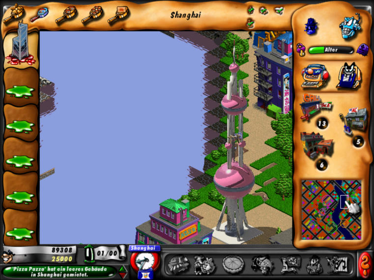 | 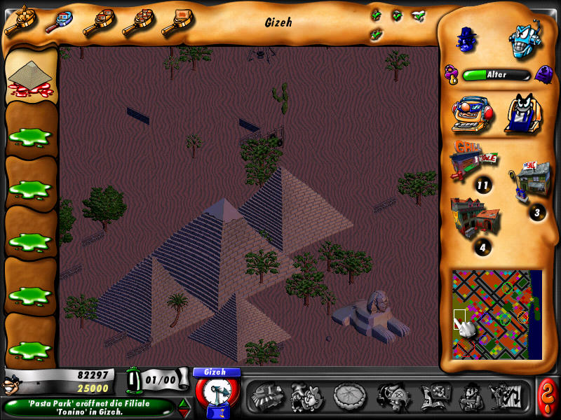 |
| Shanghai: Oriental Pearl Tower am Huangpu | Gizeh: Pyramiden und Sphinx in der Wüstenbucht |
| 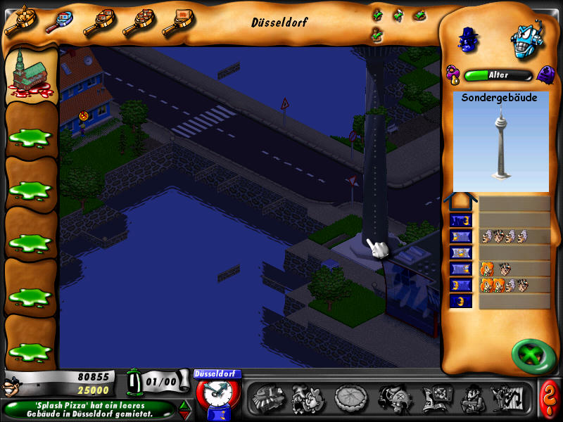 | 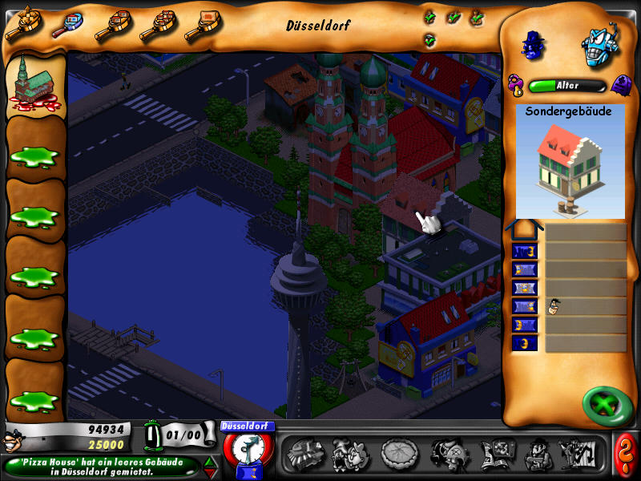 |
| Düsseldorf: Rheinturm, angeklickt, mit eigenem Infobild | Düsseldorf: Altbier-Brauhaus neben St. Lambertus |
| 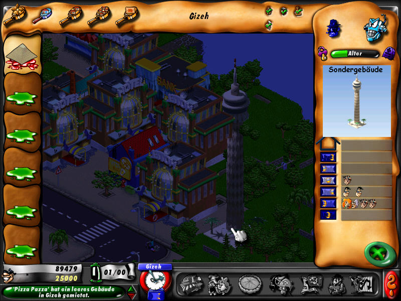 | 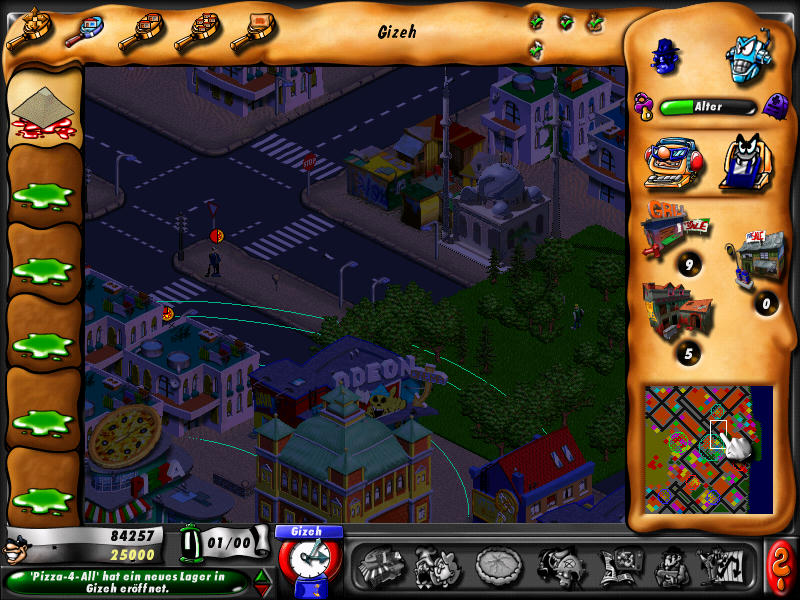 |
| Gizeh: Kairoer Fernsehturm auf der Nilinsel | Gizeh: osmanische Moschee mit zwei Minaretten |

Bildschirmfotos aus dem Spiel. Spielgrafik und Oberfläche © der jeweiligen Rechteinhaber von Pizza Syndicate, die markierten Sondergebäude sind eigene Grafiken der Mod.

## Karten

Die Bilder sind Schemabilder der Karten, keine Spielgrafik:

| Farbe | Bedeutung |
|---|---|
| Dunkelgrau | Straßen |
| Hellgrau | Plätze und Gehwege |
| Grün | Parks, außerdem die Fußwege als Linien |
| Blau | Wasser |
| Rote Linien | Fahrwege der Lieferautos |
| Orange | Wohnhäuser |
| Gelb | Freie Ladenlokale |
| Magenta | Stadien |
| Türkis | Hotels |
| Weitere Farben | Andere Gebäude |

| Neapel | Porto | Manchester |
|---|---|---|
|  | 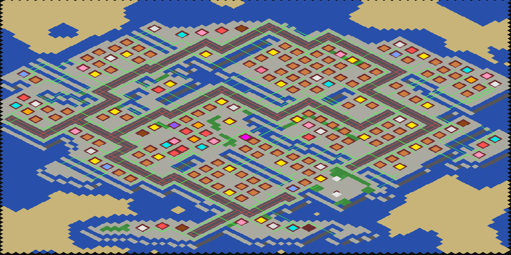 | 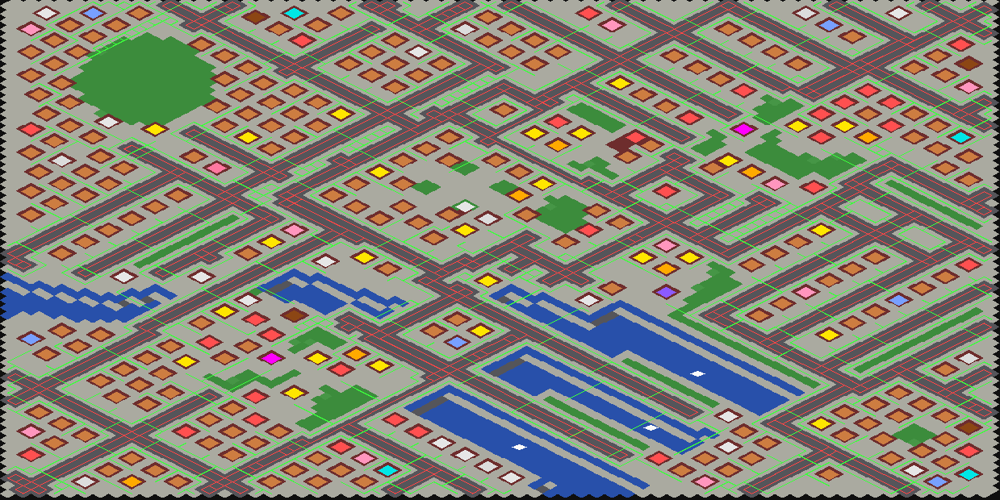 |

| Miami | Shanghai | Düsseldorf |
|---|---|---|
| 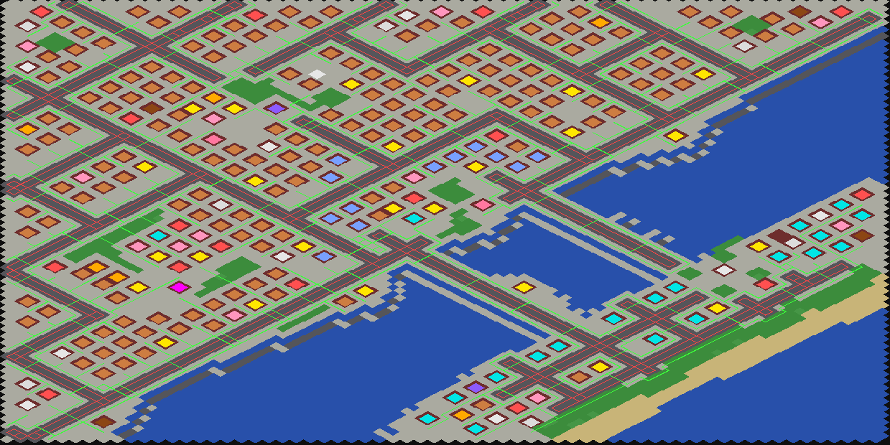 | 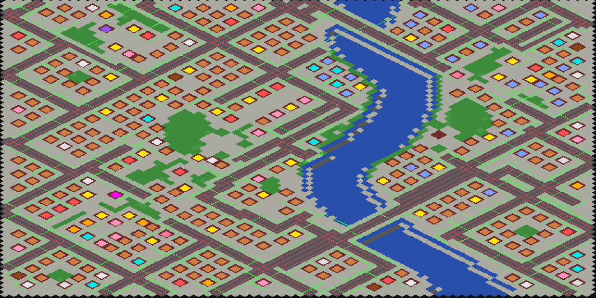 | 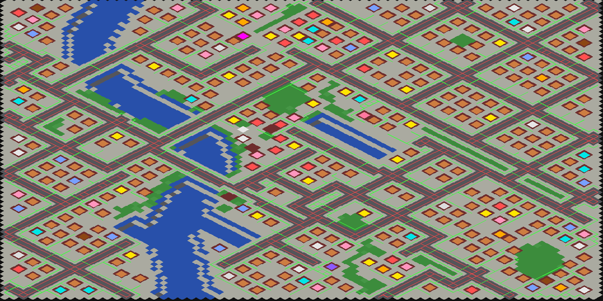 |

| Gizeh |
|---|
| 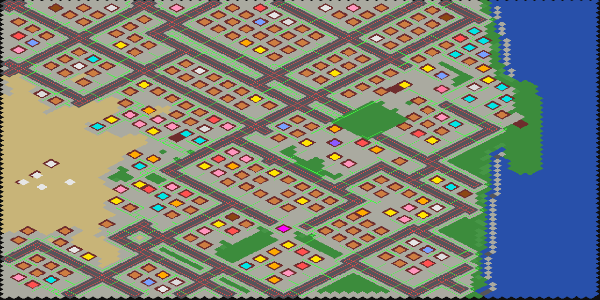 |

## Aufbau

| Pfad | Inhalt |
|---|---|
| `install.js` | Installer und Deinstaller |
| `staedte.json` | Stadtwerte: Name, Land, Kaufkraft, Preise, Touristen, Kundengruppen, Position auf der Weltkarte |
| `karten/` | Fertige Karten (`.mmp`) und Wegenetze (`.wlk`) |
| `tools/citygen/` | Kartengenerator. Erst `learn.js`, dann `build_all.js` |
| `tools/nachfrage.js` | Nachfragevergleich mit allen Originalstädten |
| `tools/art/` | Blender-Modelle der eigenen Gebäude und der Umwandler ins Spielformat |
| `gfx/` | Eigene Gebäudegrafiken im Spielformat (selbst gerendert) |
| `extras/` | Abschnitt für die `ddraw.ini` von cnc-ddraw |

## Rechtliches

Inoffizielles Fanprojekt, ohne Verbindung zu den Rechteinhabern von Pizza Syndicate. Das Repo enthält ausschließlich selbst geschriebenen Code, selbst erzeugte Karten und selbst gerenderte Gebäude. Alle Grafiken, Symbole und Fotos übernimmt der Installer aus deiner eigenen Spielinstallation.

Code und Karten stehen unter der [MIT-Lizenz](LICENSE).
